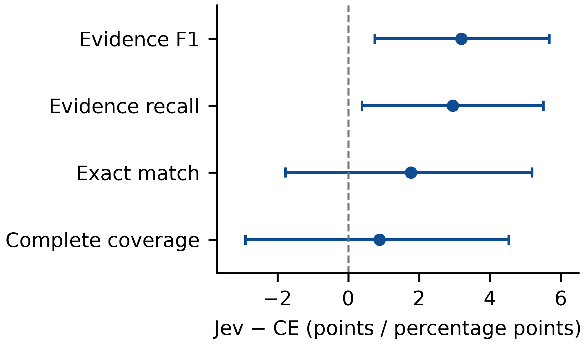
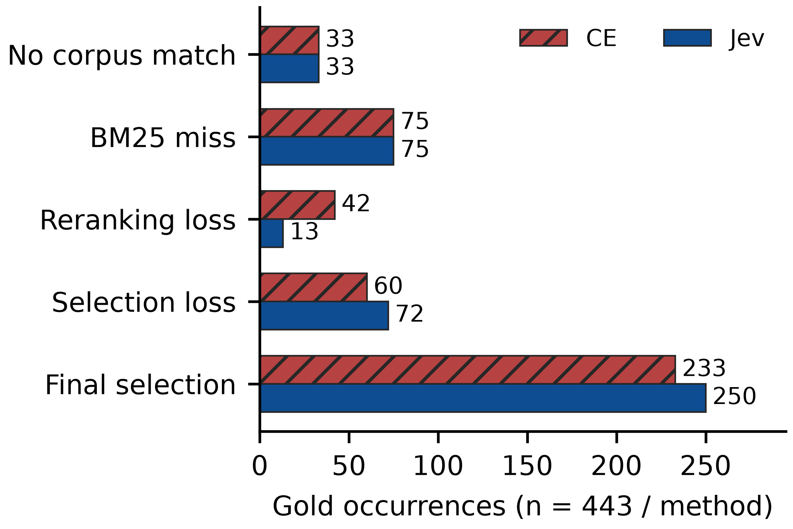

# 4. 실험 결과 및 분석

## 4.1 실험 조건 요약

KoBLEX의 한국어 법률 질문 226문항에서 ParSeR의 재정렬 모델을 Cross-Encoder(CE, `dragonkue/bge-reranker-v2-m3-ko`)에서 Decision Model인 Jev(`jev-1.14.0`)로 교체하여 평가하였다. 선택·답변 생성·자동 평가에는 `gpt-4o-2024-08-06`을 사용하였다. 두 조건은 예상 법령과 BM25 검색 후보를 공유하고, 예상 법령별 후보 100개를 재정렬한 후 상위 10개 중 LLM이 하나를 선택하였다. 후보 목록은 총 478개이며 선택 수를 정답 근거 수에 맞추지 않았다. CE 입력 형식(원 질문만 사용)은 평가 문항 30개에서 네 형식을 비교한 탐색적 진단으로 정하였으며, 공식 코드의 재정렬 입력과 같고 진단에서 CE에 가장 유리했던 이 형식을 Jev에도 적용하였다.

비교는 공개 코드 CE, 이를 수정한 CE, Jev의 세 조건으로 구성된다. 공개 코드는 현재 목록에서 선택한 번호를 첫 번째 목록에 적용하므로, 이를 보존한 조건은 재현 참조로 분리하였다. 앞의 두 조건 차이는 후보 목록 참조 수정 효과, 수정 CE와 Jev의 차이는 재정렬기 교체 효과이며, 이하 CE는 수정 조건을 뜻한다. 모든 비교는 평가(test) 문항의 결과를 이미 관찰한 뒤 수행한 탐색적 분석이다. 품질 차이의 95% 신뢰구간(CI)은 출처나 정답 근거를 공유하는 151개 그룹의 대응 bootstrap 10,000회로 산출하였고, 다중 비교를 보정하지 않았으므로 가설 생성적 근거로만 해석한다(보정 결과는 S1). 문항 평균 점수(P·R·F1, Token F1, LF-Eval)는 0–100 척도의 점, 문항 비율(EM, 완전 회수율 등)은 %와 %p로 표기한다. 지연은 hop별 층화 무작위로 미리 추출한 60문항(1/2/3-hop 15/34/11)에서 별도로 측정하고, 151개 그룹 중 표본에 해당하는 52개로 같은 방식의 구간을 산출하였다. Jev는 원격 API로 다시 호출하면 상위 10개가 달라질 수 있으므로(4.3) Jev 품질 수치는 저장된 단일 실행의 값이며, CI는 문항 표본 변동만 반영하고 실행 간 변동은 포함하지 않는다.

## 4.2 Decision Model 적용에 따른 근거 선택 성능 변화 (RQ1)

Jev 교체로 평균 최종 근거 F1은 3.19점(CI [+0.75, +5.68]점), Recall은 2.95점(CI [+0.39, +5.51]점) 높아졌으나, 필요한 근거를 모두 확보한 문항의 증가는 0과 구분되지 않았다(조건별 값은 S2). 근거 평가는 정답 근거(gold)와의 문자열 집합 일치를 보므로 정답 외 근거의 법률적 타당성은 판정하지 않는다.

**그림 1. 최종 근거 성능의 Jev−CE 차이와 탐색적 95% CI. Complete coverage는 완전 회수이며, EM·완전 회수율 차이는 %p, 나머지는 점 단위이다.**

반면 EM(선택 집합과 gold의 완전 일치)은 27.88%에서 29.65%로, 완전 회수율(정답 외 근거가 있더라도 gold를 빠짐없이 포함)은 34.07%에서 34.96%로 증가하는 데 그쳤고, 두 차이의 CI는 0을 포함하였다(그림 1).

문항별 F1은 Jev 우세 32개, 동일 177개, CE 우세 17개였다. 데이터셋 hop 라벨별 F1은 1-hop 78.07→76.90(Jev 우세/동일/CE 우세 0/56/1문항), 2-hop 53.33→57.24(20/95/12), 3-hop 47.91→54.83(12/26/4)으로, 전체 차이는 주로 2·3-hop 문항에서 관측되었다. 이는 집단별 관측 평균이며 효과 차이를 검정한 결과는 아니다. 고유 gold 386개 중 27개(29문항)는 corpus에서 동일 문자열을 찾을 수 없었으나 분석에서 제외하지 않았다(S6).

공개 코드 CE의 F1은 48.72점으로 수정 CE보다 9.85점 낮았다(해석 범위는 S2).

## 4.3 Decision Model과 Cross-Encoder의 재정렬 성능·지연시간 비교 (RQ2)

Jev는 재정렬 후 상위 10개 후보(shortlist)의 gold Recall을 5.16점 높였고(CI [+2.61, +7.94]점; CE 69.47점, Jev 74.63점), 재정렬 단계 지연은 약 2.25배였다. 모든 gold가 shortlist에 남은 문항도 112개(49.56%)에서 130개(57.52%)로 7.96%p 증가하였다(CI [+3.89, +12.38]%p). 두 구간은 결과 관찰 후 같은 절차로 추가 산출하였다(S1).

이 개선이 최종 완전 회수로 모두 이어지지는 않았다. 목록당 하나만 선택하는 제약을 반영하면 shortlist에서 모든 gold를 동시에 선택할 수 있는 문항은 CE 104개, Jev 120개였으나 실제 완전 회수는 77개와 79개였다. shortlist에 남은 gold 출현 중 최종 선택된 비율도 CE 79.52%(233/293), Jev 77.64%(250/322)로 비슷하여, Jev의 이득은 주로 재정렬 단계의 후보 유지에서 나타났고 선택 단계의 추가 이득은 관찰되지 않았다.

지연은 문항 내 중복을 제거한 질문–후보 쌍의 점수화부터 목록별 상위 10개 구성까지로 정의하고, 캐시 없이 3회 반복한 문항별 평균을 분석 단위로 하였다(측정 절차는 S9). CE는 로컬 MPS(float32·배치 50), Jev는 원격 API(동시 요청 4개)로 실행하였다.

**표 1. 재정렬 단계 지연(60문항, 초). 각 문항의 3회 평균 분포에서 계산하였다.**

| 통계량 | CE | Jev |
| --- | --- | --- |
| 평균 | 5.01 | 10.65 |
| 중앙값 | 4.82 | 10.79 |
| 문항 평균의 제95백분위수 | 8.87 | 16.53 |

Jev는 문항당 평균 5.64초 길었고(95% CI [+5.15, +6.17]초), 문항별 Jev/CE 비율의 기하평균은 2.25배(CI [2.11, 2.39])였다. 이 비교는 로컬 CE와 원격 Jev라는 배포 조건에 의존하므로 모델 고유 속도로 일반화할 수 없고, 예상 법령 생성·BM25·LLM 선택·답변 생성·모델 로드를 제외하므로 전체 응답시간의 차이를 뜻하지 않는다.

반복 실행에서 기존 품질 실험과 모든 목록의 상위 10개가 순서까지 일치한 비율은 CE 100%(180/180회), Jev 1.11%(2/180회)였고, Jev의 순서 무관 후보 겹침은 평균 91.51%였다(정의와 분포는 S9). 따라서 재호출 시 동일한 선택·답변 품질은 보장되지 않는다.

## 4.4 최종 답변의 자동 품질과 자원 사용 특성 (RQ3)

Jev의 자동 답변 지표는 Token F1이 1.12점(CI [+0.02, +2.27]점), LF-Eval이 2.58점(CI [+0.37, +4.79]점) 높았으나 Token F1의 개선은 경계적이었고, 입력량 절감은 관찰되지 않았다(조건별 값은 표 2). LF-Eval은 gold 조문의 사용을 채점 기준에 포함하므로 근거 회수 개선과 독립적인 증거가 아니다(지표 정의는 S1).

답변 생성 단계의 선택 문맥은 평균 203.67토큰에서 215.60토큰으로, 전체 API 입력은 2302.67토큰에서 2314.58토큰으로 늘었다. 문맥 길이의 문항별 차이 중앙값은 0이었고 선택 목록은 양쪽 모두 478개이므로, 이 증가는 선택 수가 아닌 선택 내용의 변화에 따른 것이다. LLM 선택 호출의 입력도 줄지 않았다(S6). 사용량은 신규 청구액이 아닌 조건별 요구량이다(S3).

선택 근거 수를 줄일 때의 자동 품질 변화를 탐색하기 위해, 저장된 최종 선택 근거에 scorer 점수 문턱값을 적용하는 선택 후 필터링을 수행하였다. 문턱값은 151개 의존 그룹의 5-fold 교차검증에서 학습 fold의 근거 F1 하락이 1점 이내인 후보 중 근거를 가장 적게 남기는 값으로 정하였고(결과 관찰 후 바꾼 격자 이력과 상세 절차는 S7), 유지 근거가 바뀐 문항(CE 10개, Jev 45개)만 같은 프롬프트와 모델로 답변을 재생성하여 평가하였다.

**표 2. 선택 후 필터링의 검증 fold 통합 결과와 답변 재평가(226문항). P·R은 근거 Precision·Recall, 완전 회수는 %이다.**

| 조건 | 유지 근거 | F1 | P | R | 완전 회수 | Token F1 | LF-Eval |
| --- | --- | --- | --- | --- | --- | --- | --- |
| CE | 478 | 58.57 | 63.46 | 57.74 | 34.07 | 46.20 | 67.57 |
| CE+필터링 | 467 | 58.54 | 64.56 | 57.15 | 33.19 | 45.65 | 67.13 |
| Jev | 478 | 61.75 | 66.85 | 60.69 | 34.96 | 47.31 | 70.15 |
| Jev+필터링 | 426 | 61.43 | 69.80 | 58.26 | 33.19 | 47.03 | 69.13 |

Jev+필터링(근거 89.12% 유지)의 근거 F1 차이는 −0.32점(CI [−1.76, +1.07]점)으로 0 근처였으나, F1이 문턱값 선택 기준이었으므로 부분적으로 설계상의 귀결이다. Precision은 2.95점(CI [+1.05, +5.01]점) 높아졌고, Recall은 2.43점(CI [−3.81, −1.16]점), 완전 회수율은 1.77%p(CI [−3.51, −0.43]%p) 낮아졌다. 답변 지표의 차이는 Token F1 −0.28점(CI [−1.10, +0.44]점), LF-Eval −1.02점(CI [−2.23, +0.15]점)이었다. CE는 근거의 97.70%를 유지하여 필터링 강도가 달랐으므로 조건 간 비교는 S7에 제시하였다. 사전에 정한 비열등성 마진이 없으므로 이 결과를 품질의 유지나 동등성으로 해석하지 않으며, 필터링에 따른 비용·지연 변화는 측정하지 않았다.

## 4.5 오류 유형 및 사례 분석

4.2–4.4의 평균 차이를 문항 수준 변화로 보이기 위해, 문항별 gold 출현 443건(집계 방식은 S4)을 최초 탈락 단계 또는 최종 선택 상태에 배정하였다(그림 2). corpus 미매핑과 BM25 미회수는 두 조건에 공통이었고, shortlist 탈락은 CE 42건에서 Jev 13건으로 줄었으나 shortlist에 남은 뒤 미선택된 출현은 60건에서 72건으로 늘었다.

**그림 2. 문항별 gold 출현 443건의 배타적 단계 분류. Reranking loss는 shortlist 탈락, Selection loss는 미선택이며, 미선택은 목록별 선택 수 제약의 영향도 받는다.**

개선·CE 우세·지표 불일치 집단에서 F1 차이 절댓값이 집단 중앙값에 가장 가까운 문항을 대표 사례로 선정하였다(식별자·선정 규칙·원문 위치는 S4). 식품 생산실적과 회수계획의 보고 상대방을 묻는 개선 사례에서 Jev는 식품위생법 제42조제2항을 유지하면서 제45조제1항을 추가로 확보하여, 근거 F1이 50→100, LF-Eval이 65.29→99.18로 높아졌다. 복수 당사자 청구 절차 사례에서는 gold인 민사소송법 제79조제1항이 Jev의 shortlist에서 탈락하고 제83조제1항이 선택되어, F1은 80→40, LF-Eval은 71.79→52.67로 낮아졌다. 사면과 복수 범죄 처리 사례는 gold 3개에 후보 목록이 2개뿐이었고(하나는 corpus 미매핑, 하나는 BM25 미회수), Jev는 CE가 선택한 나머지 gold도 확보하지 못해 근거 F1이 40→0으로 낮아졌지만 Token F1은 18.60→25.88로 상승하였다. 사례 분석은 자동 관측에 근거하며 정답 외 조문의 법률적 적절성은 판정하지 않았다.

종합하면, 저장된 단일 Jev 실행에서 재정렬기 교체는 shortlist의 gold 유지를 늘렸고(RQ2), 이와 함께 평균 근거 F1이 3.19점 높아졌으나 EM·완전 회수 차이는 불확실했으며 차이는 주로 2·3-hop 문항에서 관측되었다(RQ1). 자동 답변 지표도 소폭 높아졌으나 Token F1의 개선은 경계적이었고 입력량 절감은 관찰되지 않았다(RQ3). 재정렬 단계 지연은 약 2.25배 길었으나 배포 조건에 의존하며 품질(226문항)과 다른 실행·표본(60문항)에서 측정되었다. 공개 코드의 후보 목록 참조 수정에 따른 F1 차이(9.85점)는 재정렬기 교체에 따른 차이보다 컸다.
