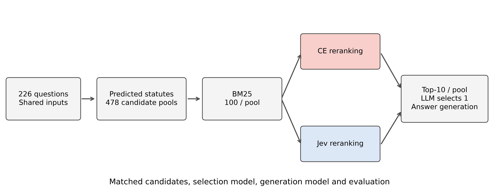
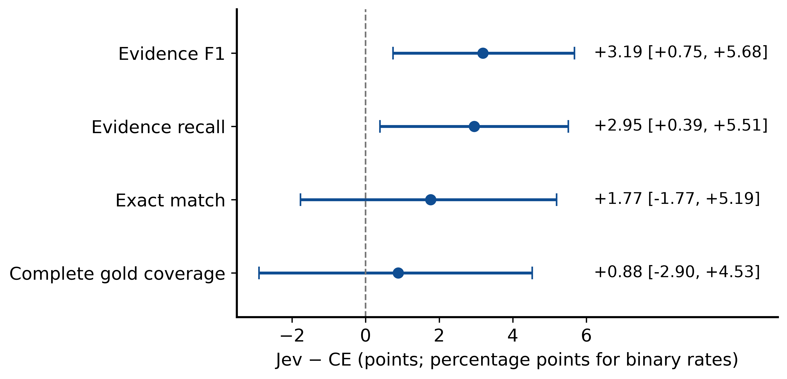
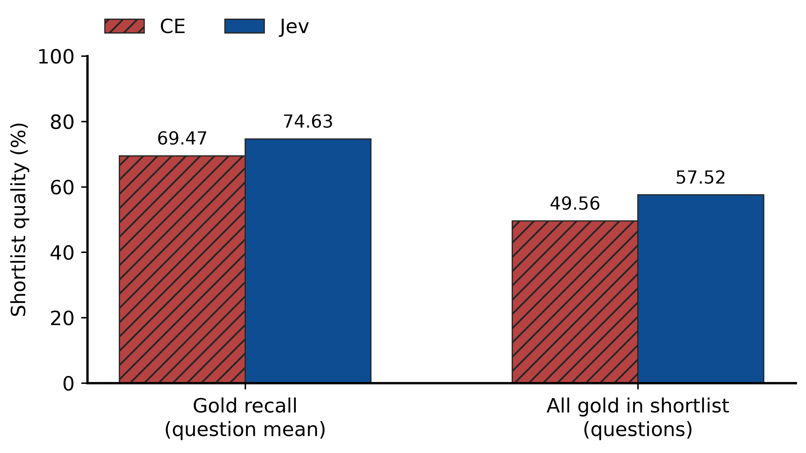
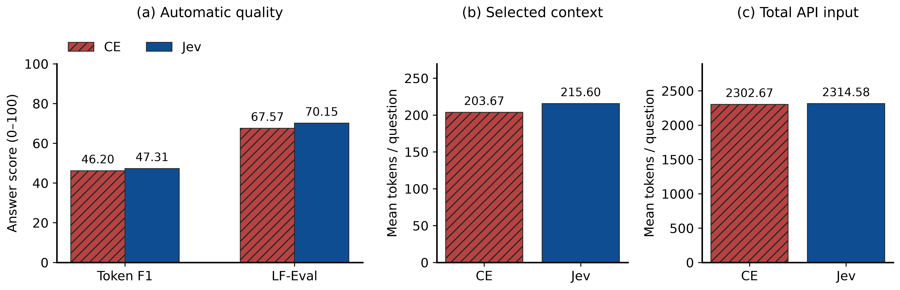
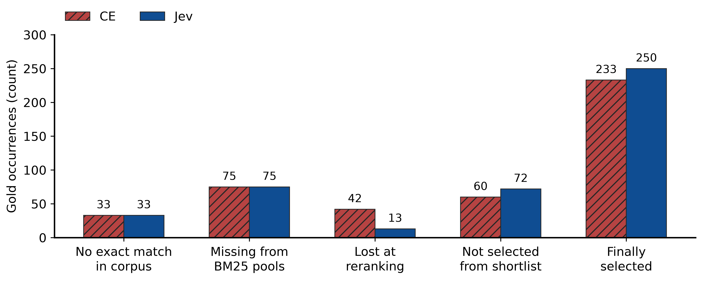

# 제4장 절별 논문 figure

완료된 기존 결과만 사용. PNG 600 dpi, 벡터 PDF/SVG, 그림별 원자료 JSON 제공. 영어 도표 레이블과 한국어 캡션을 사용한다. CE는 수정 CE다. 기존 원고·기존 그림은 변경하지 않았다.

## fig_4_1_controlled_pipeline

동일한 입력·후보와 후속 LLM을 공유하는 CE/Jev 주 비교. 공개 코드 CE는 별도 재현 참조 조건이며 그림에서 생략하였다. 100·10·1은 pool별 개수다.

[PDF](fig_4_1_controlled_pipeline.pdf) · [SVG](fig_4_1_controlled_pipeline.svg) · [원자료](fig_4_1_controlled_pipeline.data.json)

## fig_4_2_evidence_effects

최종 선택 근거의 Jev−수정 CE 차이. 막대는 151개 의존 그룹의 대응 bootstrap 10,000회로 산출한 탐색적 95% CI다. 다중 비교 무보정이며 EM·완전 회수율 구간은 0을 포함한다.

[PDF](fig_4_2_evidence_effects.pdf) · [SVG](fig_4_2_evidence_effects.svg) · [원자료](fig_4_2_evidence_effects.data.json)

## fig_4_3_shortlist_quality

재정렬 후 상위 10개 후보 합집합의 정답 근거 유지 수준(226문항). Recall은 문항별 비가중 평균, 모든 gold 포함률은 문항 비율이다. 점추정만 표시한다. 재정렬 지연은 이 그림에 포함하지 않고 본문 표 1에 별도로 제시한다.

[PDF](fig_4_3_shortlist_quality.pdf) · [SVG](fig_4_3_shortlist_quality.svg) · [원자료](fig_4_3_shortlist_quality.data.json)

## fig_4_4_answer_quality_resources

최종 답변의 자동 품질과 생성 입력 요구량(226문항). 세 패널은 서로 다른 단위·축을 사용하며 막대는 0에서 시작한다. 캐시 재사용 행도 논리적 입력량에 포함한다. 신규 청구액·근거 주장 지지율이 아니며, 오차막대는 표시하지 않았다. 입력량 절감은 관찰되지 않았다.

[PDF](fig_4_4_answer_quality_resources.pdf) · [SVG](fig_4_4_answer_quality_resources.svg) · [원자료](fig_4_4_answer_quality_resources.data.json)

## fig_4_5_gold_loss_stages

문항별 gold 출현 443건을 최초 탈락 단계 또는 최종 선택으로 배타 분류한 결과. 같은 gold가 다른 문항에 필요하면 각각 센다. shortlist 이후 미선택에는 pool별 하나 선택 제약이 작용할 수 있으므로 법률 판단 오류로 단정하지 않는다.

[PDF](fig_4_5_gold_loss_stages.pdf) · [SVG](fig_4_5_gold_loss_stages.svg) · [원자료](fig_4_5_gold_loss_stages.data.json)

4.3 재정렬 지연(60문항 벤치마크, `results/koblex-latency-v1/`)은 완료되었으며 그림이 아니라 본문 표 1로 제시한다. 4.1은 실험 조건 도식이며 결과 그래프가 아니다. 4.4 그림은 실제 제공 근거의 주장 지지 여부를 나타내지 않으며, 선택 후 필터링과 그 답변 재평가 결과는 그림이 아니라 본문 표 2(`results/koblex-filtering-v1/summary.json`, `e2e-summary.json`)로 제시한다.

## 본문 단 너비 판본

본문(`chapter4.md`)은 `build_manuscript_figures.py`가 만든 `_column` 판본만 사용한다: 그림 1 = `fig_4_2_evidence_effects_column`, 그림 2 = `fig_4_5_gold_loss_stages_column`. `fig_4_3_shortlist_quality_column`은 Stage 4 수정(2026-11-13, 로드맵 RM-10)에서 본문에서 제외되어 이 자료집에만 보존한다(차이와 사후 산출 95% CI는 본문 4.3 문장과 `results/koblex-reproduction-v1/chapter4-revision-v1/shortlist-bootstrap.json`). 그림 파일 자체는 바꾸지 않았다. 입력 data.json과 출력 PDF/PNG/SVG의 sha256은 `provenance.json`의 `manuscript_column_figures`에 기록했다.

재현: `.venv/bin/python research/chapter4/figures/section-figures-v1/build_figures.py`
